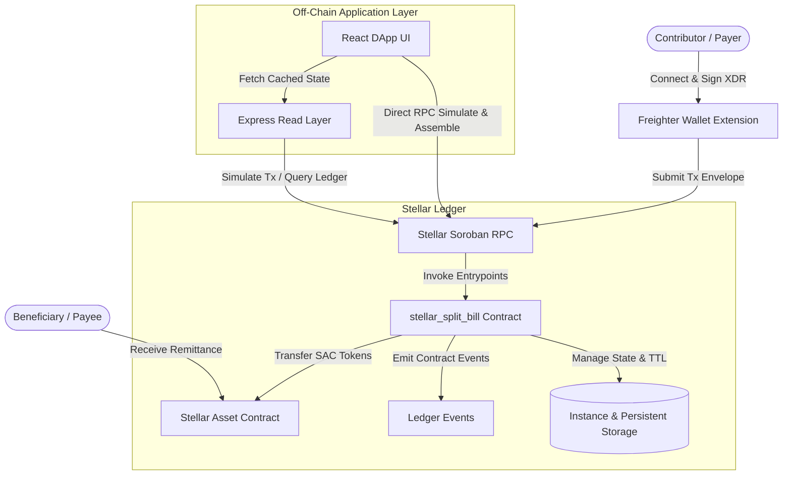

# Stellar Split: Micro-Remittance & Split-Billing Protocol

[](.github/workflows/rust.yml)
[](.github/workflows/node.yml)
[](LICENSE)
[](https://crates.io/crates/soroban-sdk)

> **Decentralized, verifiable group micro-remittance and shared expense settlement protocol built on Stellar Soroban.**

---

## 1. Problem Statement & Ecosystem Relevance

Cross-border remittances are a lifeline for households across emerging markets, representing over $800 billion annually. However, diaspora families face severe friction:
1. **Exorbitant Fees**: Traditional Money Transfer Operators (MTOs) charge 6% to 8% in fees on small-ticket remittances ($20–$100).
2. **Coordination Failure**: Shared family expenses (such as medical emergencies, school tuition, funeral rites, and utility bills) require coordination across multiple relatives abroad. One family member is often forced to bear the full expense or manually reconcile separate bank transfers.
3. **Lack of Escrow Transparency**: Senders have zero cryptographic guarantee that funds will only be disbursed once the bill target is fully funded.

**Stellar Split** solves this by leveraging Stellar's high-throughput, low-fee infrastructure and Soroban smart contracts to enable:
- **Decentralized Bill Targets**: A bill recipient (or service provider) specifies a verified target amount in XLM or Stellar Asset Contract (SAC) tokens.
- **Collaborative Micro-Payments**: Multiple contributors from across the globe contribute arbitrary fractional amounts directly from their non-custodial wallets.
- **Cryptographic Settlement**: Payments cannot exceed the remaining balance, payer cannot be payee, and funds are held under contract custody until fulfilled or remitted.

---

## 2. Architecture & Data Flow



---

## 3. Project Structure

```text
.
├── .github/
│   ├── workflows/
│   │   ├── rust.yml                 # Rustfmt, clippy, cargo test, WASM compilation
│   │   └── node.yml                 # Backend and Frontend test, lint, and build
│   ├── dependabot.yml               # Automated dependency bump schedule
│   ├── ISSUE_TEMPLATE/              # Bug report and feature request templates
│   └── PULL_REQUEST_TEMPLATE.md     # PR verification checklist
├── contracts/
│   └── stellar_split_bill/          # Soroban smart contract package
│       ├── Cargo.toml               # Rust package config (soroban-sdk 29.0.0)
│       └── src/
│           ├── lib.rs               # Hardened contract logic, errors, and events
│           └── test.rs              # 14 comprehensive Soroban unit tests
├── backend/                         # Express.js read/simulation API
│   ├── app.js                       # Modular Express app with helmet, CORS, rate limits
│   ├── index.js                     # Startup, env validation, graceful shutdown
│   ├── test/app.test.js             # 13 Jest + Supertest integration tests
│   └── package.json                 # Backend scripts and dependencies
├── frontend/                        # React Web3 application
│   ├── src/
│   │   ├── App.jsx                  # UI with Freighter wallet & Soroban RPC simulation
│   │   ├── App.test.js              # 5 React Testing Library component tests
│   │   └── index.css                # Custom glassmorphic Web3 design system
│   └── package.json                 # Frontend scripts and dependencies
├── docs/
│   ├── DEPLOYMENT.md                # Reproducible Stellar Testnet deployment guide
│   └── ROADMAP.md                   # 6 future ecosystem milestones
├── AUDIT.md                         # Phase 0 comprehensive audit findings
├── CHANGELOG.md                     # Detailed record of all improvements
├── CONTRIBUTING.md                  # Development guidelines and standards
├── LICENSE                          # Apache License 2.0
├── README.md                        # Master documentation
└── SECURITY.md                      # Security architecture & vulnerability disclosure
```

---

## 4. Smart Contract Specification

The contract (`stellar_split_bill`) is written in Rust using `soroban-sdk` v29.0.0.

### 4.1 Interface Reference

| Method | Parameters | Access | Description |
| :--- | :--- | :--- | :--- |
| `initialize` | `admin: Address` | Public (Once) | Initializes the contract admin. Can only be invoked once. |
| `create_bill` | `payee: Address, token: Address, total_amount: i128` | Payee auth | Creates a new split bill with a positive target amount. |
| `pay_bill` | `payer: Address, bill_id: u32, amount: i128` | Payer auth | Transfers tokens to contract, increments total collected, enforces limits. |
| `remit` | `bill_id: u32` | Payee auth | Remits collected funds from contract custody directly to payee. |
| `close_bill` | `bill_id: u32` | Admin auth | Admin emergency closure of a bill. |
| `emergency_stop` | None | Admin auth | Pauses all payment and creation operations. |
| `resume` | None | Admin auth | Resumes contract operations following an emergency stop. |
| `get_bill` | `bill_id: u32` | Read-only | Returns bill metadata struct (`Bill`). |
| `get_bill_count`| None | Read-only | Returns total number of registered bills. |

### 4.2 Error Codes (`#[contracterror]`)

All error conditions return typed contract errors instead of unhandled panics:

```rust
#[contracterror]
pub enum Error {
    AlreadyInitialized = 1,      // Contract has already been initialized
    NotInitialized = 2,          // Contract requires initialization first
    BillNotFound = 3,            // Specified bill ID does not exist
    BillClosed = 4,              // Bill is inactive, completed, or closed
    InvalidAmount = 5,           // Payment or target amount is <= 0
    AmountExceedsRemaining = 6,  // Payment exceeds remaining target balance
    Unauthorized = 7,            // Caller lacks required authorization
    InvalidState = 8,            // Contract or bill is in an incompatible state
    ContractPaused = 9,          // Contract is currently paused by admin
    PayeeCannotBePayer = 10,     // Payee cannot contribute to their own bill
    Overflow = 11,               // Arithmetic overflow detected in checked math
    ReentrancyGuard = 12,        // Reentrancy detected during external call
}
```

### 4.3 Typed Events (`#[contractevent]`)

The contract emits typed events via `.publish(&env)`:
- `BillCreatedEvent`: `{ bill_id, payee, total_amount, token }`
- `BillPaidEvent`: `{ bill_id, payer, amount, amount_collected }`
- `BillCompletedEvent`: `{ bill_id, total_amount, participant_count }`
- `BillClosedEvent`: `{ bill_id, admin }`
- `RemitEvent`: `{ bill_id, payee, amount }`

---

## 5. Quickstart & Local Verification

### 5.1 Run Smart Contract Tests & Lints

```bash
# 1. Run unit tests (14 passing tests)
cargo test --workspace

# 2. Run formatting and Clippy static analysis
cargo fmt --check
cargo clippy --workspace --all-targets -- -D warnings

# 3. Build release WASM binary (target/wasm32v1-none/release/stellar_split_bill.wasm)
SOROBAN_SDK_BUILD_SYSTEM_SUPPORTS_SPEC_SHAKING_V2=1 \
cargo build --package stellar_split_bill --target wasm32v1-none --release
```

### 5.2 Run Backend Verification

```bash
cd backend
npm install

# Run ESLint
npm run lint

# Run Supertest integration tests (13 passing tests)
npm test

# Start local server (default: port 3001)
npm start
```

### 5.3 Run Frontend Verification

```bash
cd frontend
npm install

# Run automated component tests (5 passing tests)
CI=true npm test

# Build production bundle
npm run build

# Start local dev server (http://localhost:3000)
npm start
```

---

## 6. Test Suite Metrics

Every claimed test suite has been executed and verified locally:

| Suite | Framework | Count | Status | Scope |
| :--- | :--- | :--- | :--- | :--- |
| **Contract** | Soroban SDK Testutils | **14 tests** | :white_check_mark: Passing | Auth, checked math, overpayment, remit, events, double-init, reentrancy lock |
| **Backend** | Jest + Supertest | **13 tests** | :white_check_mark: Passing | Bounds validation, security headers, rate limiting, BigInt serialization, 404s |
| **Frontend** | React Testing Library | **5 tests** | :white_check_mark: Passing | Wallet connection flow, tab navigation, input validation, DOM accessibility |
| **Total** | — | **32 tests** | :white_check_mark: **100% Passing** | Zero warnings, zero skips |

---

## 7. Security Model & Transparent Limitations

- **Soroban Authentication**: All state-changing operations require cryptographic authorization from the appropriate keypair (`require_auth`).
- **Ledger State Archival**: In Soroban, inactive entries are archived by the ledger network. The contract actively manages entry lifetime via `extend_ttl` on instance storage and persistent bill entries.
- **Checked Math**: All additions use `checked_add` with `Error::Overflow` traps.
- **Transparent Notice**: This codebase is currently an unaudited testnet prototype. It is intended for testing, demonstration, and evaluation. Do not deploy to Stellar Mainnet with real capital without independent third-party audits.

---

## 8. License & Governance

This project is licensed under the **Apache License, Version 2.0**. See [LICENSE](LICENSE) for details.
Contributions and security disclosures are governed by [CONTRIBUTING.md](CONTRIBUTING.md) and [SECURITY.md](SECURITY.md).